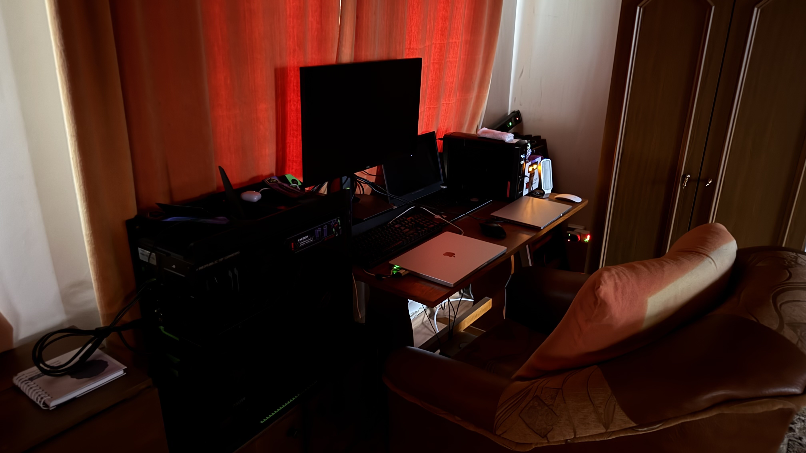

### COMPREHENSIVE ENGINEERING PORTFOLIO & OPERATIONAL ROADMAP

#### A. Systems Engineer 2026

*Saturday, 3 October 2026 17:50 | Multi-OS Fleet Directory Blueprint & AIOps Master Pathway*

--------------------------------------------------------------------------------

#### 1. EXECUTIVE SUMMARY & ARCHITECTURAL PHILOSOPHY

* **Professional Identity & Striving:**  Platform-agnostic Systems Engineer bridging 20+ years of deep low-level hardware diagnostics, custom high-performance PC architecture, and independent IT consulting with enterprise IT operations (Accenture, Genpact, NonStop Consulting). While core production-ready mastery is firmly anchored on Windows 10/11 Enterprise, active daily operations span Ubuntu Linux CLI, macOS 15+ Apple Silicon, Dual-Boot architectures, and Hyper-V virtualization, actively expanding toward cloud-native DevOps/SRE and MLOps toolchains.
* **Maintenance & Precision Mindset:**  Governed by a deterministic philosophy:  *Deterministic infrastructure is the ultimate leverage.*  Operates under strict Zero-Trust security postures, standard/admin privilege separation (UAC, least-privilege gpedit.msc, sudoers), 24-step DISM/SFC servicing recovery, and a 100% unblemished 20-year BIOS/UEFI update track record enforced via source checksum validation, dual-revision audits, AVR power stabilization, and pre-flash display redundancy.
| Stage & Timeline | Technical Focus & Domain | Core Objective & Deliverable |

| **Stage 1 (Current / 2026)** | Core Systems Engineering & Hardening | Bare-metal stability, OS debloating, security hardening, firmware reliability, and automated provisioning. |

| **Stage 2 (Mid-Term / 2–4 Years)** | Infrastructure Automation & SRE | Production-grade containerization (Docker, k3s/Kubernetes), CI/CD pipelines, robust telemetry (Prometheus/Grafana), and Infrastructure as Code (Terraform/Ansible). |

| **Stage 3 (Long-Term / 4–7+ Years)** | Platform Engineering & Architecture | Multi-cluster orchestration, zero-trust security architectures, self-healing resilient cloud/hybrid environments, and high-availability governance. |

--------------------------------------------------------------------------------

#### 2. MASTER REPOSITORY ARCHITECTURE: SYSTEM-ENGINEERING-PATHWAY

*This section reflects the master repository architecture constructed strictly and exclusively from the synchronized ticket allocations in Section 6 (Kanban Board).*

##### 📂 01-bare-metal-and-windows/ — Bare-Metal, OS Servicing & Core Diagnostics Baseline

* SYS-LEGACY-SYSINT-2026-06-05-SUNP-18.V2.md: Standard User Zero Noise Protocol (SUNP) — UAC Elimination via Task Scheduler.  *(DONE)*
* SYS-LEGACY-SYSINT-2017-08-15-STABIL-01.V1.md: Desktop I — Residential Power Instability & PSU Failure RCA.  *(DONE)*
* SYS-LEGACY-SYSINT-2026-02-08-SERVICING-01.V1.md: Desktop II — Windows Update & Servicing Stack Remediation (DISM / WinSxS Repair).  *(DONE)*
* SYS-LEGACY-SYSINT-2026-02-05-MAINT-01.V1.md: Desktop II — Physical Maintenance & CPU Thermal Repaste under Load Stress.  *(DONE)*
* SYS-LEGACY-SYSINT-2026-01-29-AUDIO-01.V1.md: Desktop II — Audio Driver Conflict & Driver Store Purge via DriverStore Explorer.  *(DONE)*
* SYS-LEGACY-SYSINT-2025-07-05-BIOS-01.V1.md: Desktop II — UEFI BIOS Firmware Flash, XMP, Secure Boot & Resizable BAR Tuning.  *(DONE)*
* SYS-LEGACY-SYSINT-2026-02-14-PERF-01.V1.md: Laptop I — Clean Install Validation & Peak Performance Certification.  *(DONE)*
* SYS-LEGACY-SYSINT-2026-02-08-CLEANOS-01.V1.md: Laptop I — Clean Windows 11 Reinstallation Baseline & Registry Artifact Purge.  *(DONE)*
* SYS-LEGACY-SYSINT-2025-12-14-PLATFORM-01.V1.md: Laptop I — Platform Management Recovery & Thermal Control.  *(DONE)*
* SYS-LEGACY-SYSINT-2026-02-08-SERVICING-02.V1.md: Laptop II — Windows Servicing Stack Failure and Recovery.  *(DONE)*
* a-sys-master-blueprint.md: Master Portfolio Blueprint & Execution Roadmap Baseline.  *(DONE)*
* SYS-LEGACY-SYSINT01-2025-09-01-INTEGRITY-01.V1.md: Comprehensive System Integrity Repair & Maintenance (sfc / DISM / chkdsk).  *(DONE)*
* SYS-LEGACY-SYSINT02-2025-09-01-STRATEGY-02.V1.md: System Maintenance Strategy & Companion Decision Framework.  *(DONE)*
* SYS-LEGACY-SYSINT-2026-07-11-TYPINGBUG-07.V1.md: Laptop II — Touchpad & Input Driver Interference Remediation (HID Sleep Disable).  *(DONE)*
* SYS-LEGACY-SYSINT-2026-01-03-DRVAUTO-01.V1.md: Laptop II — System Instability & WU Failure Following Driver Automation.  *(DONE)*
* SYS-LEGACY-SYSINT-2025-12-12-RECOVERY-01.V1.md: Windows Reinstallation, BitLocker Encryption & Servicing Recovery — Laptop II.  *(DONE)*
* EDU-MODERN-CS-2026-09-30-BOOT-03.V1.md: Interactive Algorithms & Low-Level Memory Management Study Modules.  *(To Do)*

##### 📂 02-networking-and-iam/ — Enterprise Networking & Access Control

* SYS-MODERN-NET-2026-10-HARDENING-01.V1.md: Enterprise DNS/DHCP Topology, Subnet Mapping, NetBIOS Isolation & SSH Tunneling Hardening.  *(To Do)*

##### 📂 03-linux-and-headless-ops/ — Linux Administration, KVM & Virtualization Infrastructure

* 1.AI-MODERN-SYSINT-2026-10-28-STRG-01.V2.Local.Sandbox.Lin.Manual.md: Home Lab Task 1 — Allocate Sandbox Resource Boundary (300 GB on Laptop 2 for KVM & Containers).  *(Doing)*
* 2.AI-MODERN-SYSINT-2026-10-28-HYPER-02.V2.Local.Sandbox.Lin.Manual.md: Home Lab Task 2 — Initialize Hypervisor Core & Native Container Runtime (KVM + Native Docker/K3s on Ubuntu Host EP-LIN-01).  *(Doing)*
* 3.AI-MODERN-SYSINT-2026-10-28-SYSINT-03.V2.Local.Sandbox.Win.Manual.md: Home Lab Task 3 — Provision Windows Server Evaluation Node (VM-SYSINT-WIN-01 in KVM for Active Directory / DC).  *(Doing)*
* 4.AI-MODERN-SYSINT-2026-10-28-CYBER-04.V2.Local.Sandbox.Multi.Manual.md: Home Lab Task 4 — Deploy Cybersecurity Hardening Baseline Policy (Per-Device Zero Trust Hardening).  *(Doing)*
* 5.AI-MODERN-SYSINT-2026-10-28-MESH-05.V2.Local.Sandbox.Multi.Manual.md: Home Lab Task 5 — Deploy Secure Mesh Networking via Tailscale Integration.  *(Doing)*
* 6.AI-MODERN-SYSINT-2026-10-28-ANSIBLE-06.V2.Local.Sandbox.Lin.Manual.md: Home Lab Task 6 — Infrastructure Automation & Configuration Management via Ansible (Day-2 Management over Tailscale).  *(Doing)*

##### 📂 04-containers-and-docker/ — Containerization & Lightweight Kubernetes Fabrics

* SYS-MODERN-SYSINT-2026-10-HOMELAB-02.V1.md: Docker Compose Multi-Tier Service Fabric & Containerized Monitoring Dashboards.  *(To Do)*
* SYS-MODERN-SYSINT-2026-10-K3S-03.V1.md: Lightweight k3s Kubernetes Cluster Initialization & Container Health Checks.  *(To Do)*

##### 📂 05-automation-and-iac/ — Infrastructure as Code, Ansible Playbooks & Idempotent Scripting

* SYS-LEGACY-SYSINT-2026-07-12-MODERNMAINT-09.V1.md: Modern Maintenance Protocol V1 — Idempotent OS Tuning & Anti-Drift Scripts.  *(DONE)*
* SYS-MODERN-MAINT-2026-10-PS2-01.V2.md: Idempotent PowerShell Zero-Drift Windows Debloat Automation.  *(To Do)*
* SYS-MODERN-IAC-2026-10-ANSIBLE-01.V1.md: Cross-Platform Ansible WinRM & OpenSSH Playbooks for Zero-Touch Configuration.  *(To Do)*
* SYS-MODERN-IAC-2026-10-TERRAFORM-01.V1.md: Declarative IaC Provisioning via Terraform State Configuration & Cloud Stacks.  *(To Do)*

##### 📂 06-observability-and-telemetry/ — System Telemetry, Metrics Pipelines & Thermal Monitoring

* SYS-MODERN-OBS-2026-10-TELEMETRY-01.V1.md: Prometheus & Grafana Multi-Node Metrics Pipeline with Netdata Thermal Dashboards.  *(To Do)*

##### 📂 07-aiops-and-agentic-workflows/ — Multi-LLM Pipelines, Prompt Engineering & Agentic Workflows

* AI-LEGACY-SYSINT-2026-05-10-PROD-01.V3.md: V3 Golden Standard 6-Pillar Agile Schedule Architecture Deployment.  *(DONE)*
* AI-LEGACY-SYSINT-2026-02-24-OBS-01.V1.md: 6-Step Modular Prompting Safeguard, Advocatus Diaboli Crosschecking & Sourcing Gate.  *(DONE)*
* AI-LEGACY-ORCH-2026-06-05-FLOW-01.V2.md: Multi-LLM 4-Tier Operational Flow (OneNote → Gemini Notebook RAG → Specialized LLMs → Cursor).  *(DONE)*
* AI-LEGACY-ORCH-2026-02-24-BIOHACK-01.V1.md: Cognitive Performance & Biohacking AI Prompt Framework Optimization.  *(DONE)*
* AI-LEGACY-SYSINT-2026-02-24-FRAMEWORK-04.V1.md: Standardized AI Utilization Framework for Investment Tracking Models.  *(DONE)*
* AI-MODERN-AIOPS-2026-10-PROMPT-02.V1.md: Advocatus Diaboli Prompt Cross-Checking & Counter-Argument Templates.  *(To Do)*
* AI-MODERN-AIOPS-2026-10-ORCHESTRATION-01.V1.md: Multi-LLM 4-Tier Orchestration & Agentic AI Workflows (Google AI Studio / Cursor).  *(To Do)*

##### 📂 08-governance-secops-and-gdpr/ — Endpoint Security, Dutch GDPR Compliance & Repository Governance

* MODERN-INFO-2026-10-07-MAC-MASTER-DB-01.V4.md: Apple Silicon Systems Engineering, pf Firewall & Gatekeeper/SIP Hardening.  *(DONE)*
* SYS-MODERN-SYSINT-2026-07-19-CONTINUITY-04.V1.md: macOS Continuity Cellular Handshake Failure Remediation & Token Purge.  *(DONE)*
* SYS-MODERN-SYSINT-2026-07-19-MIGRATE-05.V1.md: Cross-Platform Migration, PII Obfuscation & Dutch GDPR Data Sanitization.  *(DONE)*
* SYS-MODERN-SYSINT-2026-07-22-UIRESET-06.V1.md: macOS UI Visual Subsystem Recovery & Theme Cache Cleansing.  *(DONE)*
* SYS-MODERN-SYSINT-2026-07-22-KEEPALIVE-07.V1.md: Kernel Power Keep-Alive Assertion (pmset) & Maintenance Pipeline.  *(DONE)*
* SYS-MODERN-SYSINT-2026-10-GITHUB-01.V1.md: Public Technical Blueprints Sanitization & Module README.md Publication.  *(Doing)*

--------------------------------------------------------------------------------

#### 3. MULTI-OS FLEET MAPPING & POWER RESILIENCE LINEAGE

| Endpoint Identifier | Hardware & OS Architecture | Operational Role & Stack Profile |
| ------ | ------ | ------ |
| **EP-WIN-01 (Desktop I)** | x86_64 Intel, Windows 11 Enterprise Hardened Profile | Isolated High-Performance Gaming Node & Primary Hardened Anchor. Disables unnecessary background telemetry, enforces protected process isolation & UAC automation. |
| **EP-WIN-02 (Desktop II)** | Dual-Boot Windows 11 Enterprise / Ubuntu Linux | Multi-LLM Development Platform & Cybersecurity Sandbox. Runs local agentic workflows, Python automation, and Lynis auditing (>85 score). |
| **EP-WIN-03 (Laptop I)** | x86_64 Mobile Windows 11 Enterprise Profile | Mobile Remote Administration Node. Tuned power states (99% CPU max state on battery, G-Helper auto-profiles), uBlock DNS integration. |
| **EP-WIN-04 (Laptop II)** | x86_64 Mobile Windows Profile | Secondary Mobile Testbed. Conducts OS servicing stack recovery validation and baseline backup sync. |
| **EP-LIN-01 (Laptop II)** | x86_64 Headless Ubuntu Linux Server | KVM/libvirt Virtualization Node. Hosts evaluation VMs (VM-SYSINT-WIN-01), docker-compose microservices, and Netdata monitoring. |
| **EP-MAC-01 (Daily Driver)** | ARM64 Apple Silicon \| macOS 15+ Sequoia | Core Systems Engineer Workstation. Features UI theme cache recovery protocols, Dutch GDPR sanitized storage, and kernel-level packet filter firewall. |

##### Power Resilience Architecture (A→Z Lineage)

* **V1 — Legacy Baseline:**  Basic consumer surge strip + line-interactive UPS (inherited setup).
* **V2 — Current Stack (Romania Residence):**  Wall Outlet → ZUBR R116Y TrueRMS Digital Relay (0.04s cutoff) → External Surge Strip → Brennenstuhl Premium-Line OVP (26,000A EMI/RFI) → TED 2100SVC Servo AVR → CyberPower CP1500EPFCLCD Pure Sine UPS.
* **V3 — Enterprise Target (Netherlands Residence):**  Main Utility Grid → Main Distribution Wall Panel → DIN-Rail ZUBR D2 Relay → Type 1/2 Surge Protection Devices (SPD) → In-Wall 2.5mm² Copper Wiring → Industrial Wall Outlet → Secondary ZUBR R116Y → TED 2100SVC Servo AVR → VFI Online Double-Conversion UPS (0ms transfer time) → Multi-OS Home Lab Fleet.

--------------------------------------------------------------------------------

#### 4. OPERATING PROTOCOLS & ZERO-TRUST GOVERNANCE

##### 📌 The 'Flow-State' Operating Protocol (SOP)

1. **Clean Slate:**  Remove all non-actionable clutter. Archive outdated tasks. Terminate tasks not contributing directly to the vision.
2. **Atomize:**  Deconstruct complex engineering projects into micro-tasks under 30 minutes to eliminate cognitive friction.
3. **Execute:**  Focus exclusively on completing the immediate Next Action while maintaining system integrity.
4. **Sync:**  Post-optimization, export operational updates to PDF/Word and re-ground in OneNote and NotebookLM source vaults.
5. **Celebrate:**  Strike through completed items and enforce the Sourcing Gate before upgrading items to Done.

##### Zero-Trust Governance & Operational Contract Policies

* **Driver Governance Policy:**  Strict prohibition of unverified driver automation utilities. All system drivers must originate directly from official OEM packages or certified Windows Update repositories.
* **Dutch GDPR Compliance Policy:**  Mandatory PII obfuscation and data sanitization prior to pushing any documentation, logs, or configuration files to public repositories or cloud storage.
* **Sourcing Gate Protocol:**  No ticket or code block status is upgraded to 'Done' until Perplexity or official documentation links verify all structural parameters.

##### Core Architectural & Operational Philosophy

* **Rational Decision Framework:**  Utilizing strict logical rigor, critical thinking, and structured analysis to eliminate inefficiencies, organizational friction, and cognitive bias.
* **Technical Autonomy:**  Rejecting bureaucratic gatekeeping and corporate complacency in favor of advanced, self-taught technical mastery and hands-on system engineering.
* **Operational Resilience:**  Implementing rigorous endpoint security, low-level diagnostics, and systematic protocols (such as S.T.O.P. and D.E.C.A. frameworks) to isolate irrational actors and maintain high-performance environments.
* **Priority-Driven Architecture (Backlog Management):**  A product backlog is maintained as a continuously prioritized asset rather than a rigid chronological list.
* **Standard Intake Protocol:**  Newly created tickets or feature requests default to the bottom of the backlog to preserve stability and focus on active sprint deliverables, awaiting systematic refinement and triage by the Product Owner.
* **Exception Handling (P0 / Critical Path):**  Production blockers, high-severity bugs, or critical infrastructure outages bypass standard triage and are positioned at the top of the backlog for immediate remediation.

--------------------------------------------------------------------------------

#### 5. TECHNICAL STACK INVENTORY & OPERATIONAL BACKLOG

##### 1. Hardware Diagnostics, Power Integrity & Firmware (Physical Foundation)

*Everything begins at the wall socket and physical component integrity. Without a solid electrical baseline and low-level diagnostics, any system is inherently fragile.*

* **Low-Level Hardware Diagnostics & Troubleshooting:**  Root Cause Analysis (RCA), kernel memory dump analysis (WinDbg).
* **Power Resilience Hardware Layers:**  Type 1/2 Surge Protection Devices (SPDs); ZUBR Voltage Cutoff Relays (over/under-voltage protection); TED Automatic Voltage Regulators (AVR); VFI Double-Conversion UPS (Uninterruptible Power Supply).
  * 🟢 [SYS-LEGACY-SYSINT-2017-08-15-STABIL-01.V1]  **Completed & Verified (12 Oct 2026):**  Desktop I Residential Power Instability & PSU Failure RCA (EP-WIN-01) — Replaced degraded PSU, upgraded wall sockets, deployed 1500VA UPS & 2100VA AVR for 100% power stability.
* **Firmware Maintenance:**  20-year zero-brick BIOS/UEFI update protocols.
* **Thermal & Power Integrity:**  Workstation-grade motherboards, robust VRMs, low-ripple Power Supply Units (PSUs), precision airflow, and thermal management.

##### 2. Operating Systems & Low-Level Administration

*Once hardware is powered and stable, we move to operating systems managing bare-metal resources and virtualized environments.*

* **Windows 10 / 11 Enterprise Administration:**  Deep local administration, policy enforcement (gpedit.msc, regedit), Event Viewer diagnostics, and UAC privilege handling.
  * 🟢 [SYS-LEGACY-SYSINT-2026-06-05-SUNP-18.V2]  **Completed & Verified (12 Oct 2026):**  Standard User Zero Noise Protocol (SUNP) — UAC Elimination (EP-WIN-01/02/03) — Created ZeroNoisePipeline in Task Scheduler; silent elevated execution for SFC/DISM/Defrag.
  * 🟢 [SYS-LEGACY-SYSINT-2026-02-08-SERVICING-01.V1]  **Completed & Verified (12 Oct 2026):**  Desktop II Windows Update & Servicing Stack Remediation (EP-WIN-02) — SoftwareDistribution & catroot2 reset; repaired WinSxS store via DISM with 0 integrity errors.
  * 🟢 [SYS-LEGACY-SYSINT-2026-02-05-MAINT-01.V1]  **Completed & Verified (12 Oct 2026):**  Desktop II Physical Maintenance & CPU Thermal Repaste (EP-WIN-02) — Internal ESD cleaning, fan blade dust removal, thermal paste replaced, load stress certified.
  * 🟢 [SYS-LEGACY-SYSINT-2026-01-29-AUDIO-01.V1]  **Completed & Verified (12 Oct 2026):**  Desktop II Audio Driver Conflict & Driver Store Purge (EP-WIN-02) — Corrupted 3rd-party audio drivers purged via DriverStore Explorer; OEM platform drivers installed.
  * 🟢 [SYS-LEGACY-SYSINT-2025-07-05-BIOS-01.V1]  **Completed & Verified (12 Oct 2026):**  Desktop II UEFI BIOS Firmware Flash & Platform Tuning (EP-WIN-02) — Controlled UEFI flash; restored XMP, Secure Boot, TPM 2.0, Resizable BAR; multireboot POST pass.
  * 🟢 [SYS-LEGACY-SYSINT-2026-02-14-PERF-01.V1]  **Completed & Verified (12 Oct 2026):**  Laptop I Clean Install Validation & Peak Certification (EP-WIN-03) — System Restore rollback test pass; 0 Device Manager conflicts; verified sustained CPU/GPU boost clocks under load.
  * 🟢 [SYS-LEGACY-SYSINT-2026-02-08-CLEANOS-01.V1]  **Completed & Verified (12 Oct 2026):**  Laptop I Clean Windows 11 Reinstallation Baseline (EP-WIN-03) — Strategic clean OS rebuild from official media; purged servicing inconsistencies and registry artifacts.
  * 🟢 [SYS-LEGACY-SYSINT-2025-12-14-PLATFORM-01.V1]  **Completed & Verified (12 Oct 2026):**  Laptop I Platform Management Recovery & Thermal Control (EP-WIN-03) — DDU GPU driver cleanup; reinstalled OEM management suite; fan curves and C++/.NET runtimes restored.
  * 🟢 [SYS-LEGACY-SYSINT-2026-02-08-SERVICING-02.V1]  **Completed & Verified (12 Oct 2026):**  Laptop II Windows Servicing Stack Failure and Recovery (EP-WIN-04) — Remediated servicing stack failure blocking DISM/WU; SoftwareDistribution reset.
* **Ubuntu Linux CLI:**  Headless server operations, shell scripting, systemctl/journalctl service management, and network diagnostics (ip, ss).
* **macOS (15+ Apple Silicon):**  Unix-based workstation optimization, ad-hoc binary signing, entitlements configuration, and native toolchain execution.
  * 🟢 [MODERN-INFO-2026-10-07-MAC-MASTER-DB-01.V4]  **Completed & Verified (12 Oct 2026):**  Apple Silicon Systems Engineering & Security (EP-MAC-01) — Enforced pf firewall, dscl UID >= 501 filtering, Gatekeeper/SIP hardening, pmset keepalive, GDPR sanitized.
  * 🟢 [SYS-MODERN-SYSINT-2026-07-19-CONTINUITY-04.V1]  **Completed & Verified (12 Oct 2026):**  macOS Continuity Cellular Handshake Failure — Ecosystem Fixes (EP-MAC-01 & iOS 18+) — Purged stale tokens; re-aligned 1:1 FaceTime schemas and verified call relay under pf stealth rules.
  * 🟢 [SYS-MODERN-SYSINT-2026-07-19-MIGRATE-05.V1]  **Completed & Verified (12 Oct 2026):**  Cross-Platform Migration & GDPR Sanitization (EP-MAC-01 Baseline) — Fleet migration to Apple Silicon daily driver with PII obfuscation applied.
  * 🟢 [SYS-MODERN-SYSINT-2026-07-22-UIRESET-06.V1]  **Completed & Verified (12 Oct 2026):**  macOS UI Visual Subsystem Recovery & Theme Cache Cleansing (EP-MAC-01) — Cleared stuck Dock icons and desktop UI freezes; verified Light/Dark/Auto rendering.
  * 🟢 [SYS-MODERN-SYSINT-2026-07-22-KEEPALIVE-07.V1]  **Completed & Verified (12 Oct 2026):**  Kernel Power Keep-Alive Assertion & Scheduled Maintenance Pipeline (EP-MAC-01) — Prevented display/system idle sleep during long-running tasks via pmset assertions.
* **Dual-Boot & Multi-Boot Architectures:**  Multi-OS environment management and partition-level isolation.
* **Virtualization Platforms (Home Lab Foundation):**  Hyper-V (Windows Server/Client), Native Linux KVM, libvirt, VirtualBox, and Proxmox VE (multi-VM sandboxing).
  * 🟡 [1.AI-MODERN-SYSINT-2026-10-28-STRG-01.V2.Local.Sandbox.Lin.Manual]  **In Progress (Active Sprint):**  Home Lab Task 1 — Allocate Sandbox Resource Boundary (300 GB on Laptop 2 drive for VM disk pool & container storage; bootable USB fallback prepared).
  * 🟡 [2.AI-MODERN-SYSINT-2026-10-28-HYPER-02.V2.Local.Sandbox.Lin.Manual]  **In Progress (Active Sprint):**  Home Lab Task 2 — Initialize Hypervisor Core & Native Container Runtime (KVM qemu-kvm/libvirt/virt-manager + native Docker & K3s container runtime environment on Ubuntu host EP-LIN-01).
  * 🟡 [3.AI-MODERN-SYSINT-2026-10-28-SYSINT-03.V2.Local.Sandbox.Win.Manual]  **In Progress (Active Sprint):**  Home Lab Task 3 — Provision Windows Server Evaluation Node (VM-SYSINT-WIN-01 inside KVM for Active Directory & Domain Controller simulation with slmgr /rearm tracking log).
  * 🟡 [4.AI-MODERN-SYSINT-2026-10-28-CYBER-04.V2.Local.Sandbox.Multi.Manual]  **In Progress (Active Sprint):**  Home Lab Task 4 — Deploy Cybersecurity Hardening Baseline Policy (Per-device manual cybersecurity baseline hardening across physical endpoints and VMs following Zero Trust policy).
  * 🟡 [5.AI-MODERN-SYSINT-2026-10-28-MESH-05.V2.Local.Sandbox.Multi.Manual]  **In Progress (Active Sprint):**  Home Lab Task 5 — Deploy Secure Mesh Networking via Tailscale Integration (Install & authenticate Tailscale client on each hardened device, configure Tailnet, MagicDNS, and ACLs).
  * 🟡 [6.AI-MODERN-SYSINT-2026-10-28-ANSIBLE-06.V2.Local.Sandbox.Lin.Manual]  **In Progress (Active Sprint):**  Home Lab Task 6 — Infrastructure Automation & Configuration Management via Ansible (Deploy Ansible on EP-LIN-01, configure inventory over Tailscale 100.x.x.x IPs, and execute Day-2 configuration playbooks).
* **OS Servicing & Integrity Repair:**  sfc /scannow (binary file verification), DISM /Online /Cleanup-Image /RestoreHealth (WinSxS component store repair).
  * 🟢 [a-sys-master-blueprint.md]  **Completed & Verified (12 Oct 2026):**  Master Portfolio Blueprint & Execution Roadmap Baseline (Cross-Platform Baseline) — Finalized portfolio blueprint and execution roadmap in PDF and DOCX.
  * 🟢 [SYS-LEGACY-SYSINT01-2025-09-01-INTEGRITY-01.V1]  **Completed & Verified (12 Oct 2026):**  Comprehensive System Integrity Repair & Maintenance (Cross-Platform Baseline) — Executed sfc/chkdsk/DISM component cleanup and network stack reset; zero violations.
  * 🟢 [SYS-LEGACY-SYSINT02-2025-09-01-STRATEGY-02.V1]  **Completed & Verified (12 Oct 2026):**  System Maintenance Strategy & Preventive Framework (Cross-Platform Baseline) — Established companion decision framework for preventive maintenance and OS stability.

##### 3. Advanced Management, Diagnostics & Sysinternals (Windows)

*Deep troubleshooting and diagnostic tools.*

* **Process Explorer & Process Monitor (ProcMon):**  Real-time process inspection, file system, and registry activity tracing.
* **Sysmon:**  Advanced system monitoring and log generation for threat detection.
* **Autoruns:**  Startup persistence inspection and autostart point management.
* **Coreinfo:**  Processor and system architecture enumeration.

##### 4. Networking, Identity, Access & Perimeter Security

*Isolation, routing, access control, and network perimeter hardening.*

* **TCP/IP Stack & Routing:**  Subnetting, packet routing, virtual network interfaces.
* **DNS & DHCP Configuration:**  Enterprise naming and dynamic IP allocation mapping.
  * 🔴 [SYS-MODERN-NET-2026-10-HARDENING-01.V1]  **TODO (Pending Execution):**  Enterprise DNS/DHCP Topology & SSH Tunneling Hardening (Cross-platform baseline, subnet mapping, NetBIOS isolation, and UFW network filtering).
* **Admin, Rights & Privilege Management:**  2-Layer Access Rights: Share Permissions vs. NTFS Permissions boundary enforcement. User & Group management across Windows and Linux, chmod/chown, sudoers configuration, Least Privilege enforcement, and UAC privilege management via Administrator Task Scheduler.
* **Remote Connectivity & Administration:**  RDP tunneling/hardening, OpenSSH server/client configuration (Windows and Linux), secure remote shell management, and remote troubleshooting.
* **Security & Endpoint Hardening:**  LSASS RunAsPPL  credential protection, RDP attack surface mitigation, NetBIOS isolation, USB access restriction rules, UFW, Fail2Ban, and Lynis security auditing (>85 score).
  * 🟡 [SYS-MODERN-SYSINT-2026-10-GITHUB-01.V1]  **In Progress (Active Sprint):**  Public Technical Blueprints Sanitization & Module README.md Publication (GitHub voineaadi) — Public technical blueprints sanitized & deployed across all modules.

##### 5. Scripting, Automation & Telemetry (Cross-Platform)

*Transitioning from manual administration to autonomous maintenance, cross-platform scripting, and real-time observability.*

* **Python:**  Automation scripts, backend CS logic, log parsing, liveness watchdogs monitoring container sockets/process states, automated recovery routines for failed service layers, virtual environments (venv), Homebrew integration, data structures, generator pipelines, and Visual Studio Code development workflows (Pylance, Jupyter extensions).
* **PowerShell:**  Idempotent OS maintenance, anti-drift servicing scripts, cmdlet orchestration, WinRM remote execution, and automated administrative task scheduling.
  * 🔴 [SYS-MODERN-MAINT-2026-10-PS2-01.V2]  **TODO (Pending Execution):**  Convert manual debloat checklist into idempotent, scriptable zero-drift Windows debloat automation deployed on EP-WIN-02.
  * 🟢 [SYS-LEGACY-SYSINT-2026-07-12-MODERNMAINT-09.V1]  **Completed & Verified (12 Oct 2026):**  Modern Maintenance Protocol V1 — Idempotent OS Tuning (Cross-Platform Baseline) — Implemented idempotent OS tuning & anti-drift scripts deployed across Windows endpoints.
* **Bash (Linux CLI Automation):**  System administration scripts, pipeline automation, cron job orchestration, headless operational tooling, and network/service health checking utilities (ip, ss, systemctl, journalctl).
* **Telemetry & Operational Hygiene:**  Local Linux system utilities combined with Netdata for high-frequency kernel profiling, real-time telemetry, and thermal monitoring.
  * 🟢 [SYS-LEGACY-SYSINT-2026-07-11-TYPINGBUG-07.V1]  **Completed & Verified (12 Oct 2026):**  Laptop II Touchpad & Input Driver Interference Remediation (EP-WIN-04) — Root cause ID via Gemini LLM diagnostics; disabled selective USB/HID power-saving suspend modes; dual-layer hardware/software touchpad disablement; cursor skipping eliminated and typing accuracy 100% restored.
  * 🟢 [SYS-LEGACY-SYSINT-2026-01-03-DRVAUTO-01.V1]  **Completed & Verified (12 Oct 2026):**  Laptop II System Instability and Windows Update Failure Following Driver Automation (EP-WIN-04) — Isolated unrecoverable servicing stack corruption caused by third-party updaters; clean OS reinstallation sequence established.
  * 🟢 [SYS-LEGACY-SYSINT-2025-12-12-RECOVERY-01.V1]  **Completed & Verified (12 Oct 2026):**  Windows Reinstallation, Stability Restoration, and Servicing Recovery — Laptop II (EP-WIN-04) — Full system drive wipe, clean OS deployment, BitLocker encryption active, 100% official OEM driver integration, verified cumulative patch installation, zero crash events.

##### 6. Configuration Management, IaC & Containers

*Large-scale orchestration via Infrastructure as Code and running services in isolated environments.*

* **Infrastructure as Code (IaC):**
  * 🔴 [SYS-MODERN-IAC-2026-10-ANSIBLE-01.V1]  **TODO (Pending Execution):**  Cross-Platform Ansible WinRM & OpenSSH Playbooks (Zero-touch configuration management deployed across EP-WIN-02 and EP-LIN-01).
  * 🔴 [SYS-MODERN-IAC-2026-10-TERRAFORM-01.V1]  **TODO (Pending Execution):**  Declarative IaC Provisioning via Terraform & Cloud Stacks (State configuration and AWS/Azure deployment scripts verified).
* **Containerization & Orchestration:**
  * **Docker:**  (VM vs. container architecture, non-root user isolation, multi-container Docker Compose fabrics).
    * 🔴 [SYS-MODERN-SYSINT-2026-10-HOMELAB-02.V1]  **TODO (Pending Execution):**  Deploy docker-compose.yml multi-tier service fabric for monitoring on EP-LIN-01 (Ubuntu KVM), wi th containerized monitoring dashboards active.
  * **Lightweight Kubernetes:**  (k3s cluster architecture, Helm charts).
    * 🔴 [SYS-MODERN-SYSINT-2026-10-K3S-03.V1]  **TODO (Pending Execution):**  Initialize lightweight Kubernetes cluster with health checks on VM-SYSINT-LIN-01.

##### 7. Observability, AI Orchestration & AIOps

*The upper tier: global metrics, continuous learning, and integrating AI agents directly into daily operational workflows.*

* **Prometheus & Grafana:**  Time-series metric collection, scraping, multi-node metrics dashboarding (EP-LIN-01 / EP-MAC-01), and visualization.
  * 🔴 [SYS-MODERN-OBS-2026-10-TELEMETRY-01.V1]  **TODO (Pending Execution):**  Prometheus & Grafana Multi-Node Metric Pipeline.
* **Continuous Learning & Study Modules:**  Structured algorithmic problem-solving and computer science fundamentals (Boot.dev / Coursera / Brilliant), focusing on core data structures, algorithmic complexity (Big-O analysis), and low-level memory management benchmarks (stack vs. heap allocation, pointer hygiene, and resource optimization) verified through practical code execution.
  * 🔴 [EDU-MODERN-CS-2026-09-30-BOOT-03.V1]  **TODO (Pending Execution):**  Complete interactive algorithms and memory management study modules (Core algorithms and low-level memory benchmarks verified).
* **Multi-LLM Orchestration & AIOps:**  Rigorous prompt engineering protocols and a structured 4-tier operational flow: OneNote ➔ Gemini Notebook (RAG) ➔ Specialized LLMs ➔ Google AI Studio / Cursor.
  * 🟢 [AI-LEGACY-SYSINT-2026-05-10-PROD-01.V3]  **Completed & Verified (12 Oct 2026):**  V3 Golden Standard Schedule Architecture Deployment (Personal Productivity) — Deployed agile, non-timeboxed 6-pillar schedule architecture, replacing rigid V2 time-boxing.
  * 🟢 [AI-LEGACY-SYSINT-2026-02-24-OBS-01.V1]  **Completed & Verified (12 Oct 2026):**  6-Step Modular Prompting Safeguard & Sourcing Gate (Multi-LLM Workflows) — Established 6-step modular prompting protocol with Advocatus Diaboli crosschecking.
  * 🟢 [AI-LEGACY-ORCH-2026-06-05-FLOW-01.V2]  **Completed & Verified (12 Oct 2026):**  Multi-LLM Orchestration & Structured AI Workflow Methodology (Cross-Platform Baseline) — Deployed 4-tier operational flow fully operational.
  * 🟢 [AI-LEGACY-ORCH-2026-02-24-BIOHACK-01.V1]  **Completed & Verified (12 Oct 2026):**  Biohacking Protocol Optimization & AI Prompt Framework (Cross-Platform Baseline) — Optimized cognitive performance prompt framework and operationalized health/biohacking protocols.
  * 🟢 [AI-LEGACY-SYSINT-2026-02-24-FRAMEWORK-04.V1]  **Completed & Verified (12 Oct 2026):**  Structured AI Usage Framework for Personal Projects (Cross-Platform Baseline) — Established standardized AI utilization framework for investment tracking models.
  * 🔴 [AI-MODERN-AIOPS-2026-10-PROMPT-02.V1]  **TODO (Pending Execution):**  Document Advocatus Diaboli prompt cross-checking in 07-aiops/ on EP-MAC-01 / Cloud (Sourcing gate and counter-argument prompt templates finalized).
  * 🔴 [AI-MODERN-AIOPS-2026-10-ORCHESTRATION-01.V1]  **TODO (Pending Execution):**  Multi-LLM 4-Tier Orchestration & Agentic AI Workflows (Agentic pipeline integrated into daily ops).

--------------------------------------------------------------------------------

#### 6. KANBAN BOARD

##### 🔴 1. To Do (Planned Backlog Items)

*Synchronized Kanban Table — Stage 1: Planned Micro-Tasks & Queued Sprints awaiting active execution across the multi-OS fleet*

| Ticket ID | Objective & Scope | Target Endpoint | Status & Definition of Done | Date Added | Outcome |
| ------ | ------ | ------ | ------ | ------ | ------ |
| **AI-MODERN-AIOPS-2026-10-PROMPT-02.V1** | Document Advocatus Diaboli prompt cross-checking in 07-aiops/ | EP-MAC-01 / Cloud | 🔴 Planned — Sourcing Gate and counter-argument prompt templates finalized | 14 Oct 2026 | Pending Execution |
| **EDU-MODERN-CS-2026-09-30-BOOT-03.V1** | Complete interactive algorithms and memory management study modules | Cross-Platform | 🔴 Planned — Core algorithms and low-level memory benchmarks verified | 30 Sep 2026 | Flexible |
| **SYS-MODERN-MAINT-2026-10-PS2-01.V2** | Convert manual debloat checklist into idempotent PowerShell script | Cross-Platform | 🔴 Planned — Scriptable zero-drift Windows debloat automation deployed | 14 Oct 2026 | Pending Execution |
| **SYS-MODERN-SYSINT-2026-10-HOMELAB-02.V1** | Deploy docker-compose.yml multi-tier service fabric for monitoring | EP-LIN-01 (Ubuntu KVM) | 🔴 Planned — Containerized monitoring fabric active with system health dashboards | 14 Oct 2026 | Pending Execution |
| **SYS-MODERN-SYSINT-2026-10-K3S-03.V1** | Initialize k3s lightweight Kubernetes cluster with health checks | EP-LIN-01 (Native K3s) | 🔴 Planned — Lightweight Kubernetes cluster initialized with container health checks | 14 Oct 2026 | Pending Execution |
| **SYS-MODERN-NET-2026-10-HARDENING-01.V1** | Active Expansion Task 1 — Enterprise DNS/DHCP Topology & SSH Tunneling Hardening | Cross-Platform Baseline | 🔴 Planned — Subnet mapping, NetBIOS isolation, and UFW network filtering active | 16 Oct 2026 | Pending Execution |
| **SYS-MODERN-IAC-2026-10-ANSIBLE-01.V1** | Active Expansion Task 2 — Cross-Platform Ansible WinRM & OpenSSH Playbooks | EP-WIN-02 / EP-LIN-01 | 🔴 Planned — Zero-touch Ansible playbooks deployed for automated configuration management | 16 Oct 2026 | Pending Execution |
| **SYS-MODERN-IAC-2026-10-TERRAFORM-01.V1** | Active Expansion Task 3 — Declarative IaC Provisioning via Terraform & Cloud Stacks | Cross-Platform / Cloud | 🔴 Planned — Terraform state configuration & AWS/Azure deployment scripts verified | 16 Oct 2026 | Pending Execution |
| **SYS-MODERN-OBS-2026-10-TELEMETRY-01.V1** | Active Expansion Task 4 — Prometheus & Grafana Multi-Node Metric Pipeline | EP-LIN-01 / EP-MAC-01 | 🔴 Planned — Containerized metrics collection & Netdata real-time thermal dashboards | 16 Oct 2026 | Pending Execution |
| **AI-MODERN-AIOPS-2026-10-ORCHESTRATION-01.V1** | Active Expansion Task 5 — Multi-LLM 4-Tier Orchestration & Agentic AI Workflows | EP-MAC-01 / Cloud | 🔴 Planned — Agentic pipeline (Google AI Studio, Cursor) integrated into daily ops | 16 Oct 2026 | Pending Execution |

##### 🟡 2. Doing (Active Sprint & In-Progress Tasks)

*Synchronized Kanban Table — Stage 2: Active Operations & Daily Operational Loop*

| Ticket ID | Objective & Scope | Target Endpoint | Status & Definition of Done | Date Added | Outcome |
| ------ | ------ | ------ | ------ | ------ | ------ |
| **SYS-MODERN-SYSINT-2026-10-GITHUB-01.V1** | Publish README.md across all modules (Public Teaser) | GitHub voineaadi | 🟡 In Progress — Public technical blueprints sanitized & deployed | 12 Oct 2026 | Active Sprint (In Progress) |
| **1.AI-MODERN-SYSINT-2026-10-28-STRG-01.V2.Local.Sandbox.Lin.Manual** | Home Lab Task 1 — Allocate Sandbox Resource Boundary (300 GB on Laptop 2) | Laptop 2 / EP-LIN-01 | 🟡 In Progress — Reserve 300 GB storage pool for VM disk images & container storage | 28 Oct 2026 | Active Sprint (In Progress) |
| **2.AI-MODERN-SYSINT-2026-10-28-HYPER-02.V2.Local.Sandbox.Lin.Manual** | Home Lab Task 2 — Initialize Hypervisor Core & Native Container Runtime | EP-LIN-01 (Ubuntu 24.04) | 🟡 In Progress — Provision KVM & native Docker/K3s runtime environment on host | 28 Oct 2026 | Active Sprint (In Progress) |
| **3.AI-MODERN-SYSINT-2026-10-28-SYSINT-03.V2.Local.Sandbox.Win.Manual** | Home Lab Task 3 — Provision Windows Server Evaluation Node | VM-SYSINT-WIN-01 | 🟡 In Progress — Deploy Windows Server Eval VM in KVM; Active Directory / DC simulation & slmgr /rearm log | 28 Oct 2026 | Active Sprint (In Progress) |
| **4.AI-MODERN-SYSINT-2026-10-28-CYBER-04.V2.Local.Sandbox.Multi.Manual** | Home Lab Task 4 — Deploy Cybersecurity Hardening Baseline Policy | Multi-Node / All Devices | 🟡 In Progress — Per-device manual cybersecurity baseline hardening policy applied (Zero Trust) | 28 Oct 2026 | Active Sprint (In Progress) |
| **5.AI-MODERN-SYSINT-2026-10-28-MESH-05.V2.Local.Sandbox.Multi.Manual** | Home Lab Task 5 — Deploy Secure Mesh Networking via Tailscale Integration | Multi-Node / Tailnet Mesh | 🟡 In Progress — Install Tailscale on hardened devices; configure Tailnet, MagicDNS & ACLs | 28 Oct 2026 | Active Sprint (In Progress) |
| **6.AI-MODERN-SYSINT-2026-10-28-ANSIBLE-06.V2.Local.Sandbox.Lin.Manual** | Home Lab Task 6 — Infrastructure Automation & Configuration Management via Ansible | EP-LIN-01 -> Tailnet Fleet | 🟡 In Progress — Deploy Ansible on EP-LIN-01; configure inventory over Tailscale 100.x.x.x IPs & Day-2 playbooks | 28 Oct 2026 | Active Sprint (In Progress) |

##### 🟢 3. Done (Completed & Verified Deliverables)

*Synchronized Kanban Table — Stage 3: Completed & Verified Production Deliverables (30 Master Tickets)*   *Fully verified production deliverables backed by Sourcing Gate validation:*

| Ticket ID | Objective & Scope | Target Endpoint | Status | Date Added / Done | Completion / Outcome | Link |
| ------ | ------ | ------ | ------ | ------ | ------ | ------ |
| **1. SYS-LEGACY-SYSINT-2026-06-05-SUNP-18.V2** | Standard User Zero Noise Protocol (SUNP) — UAC Elimination | Cross-Platform (EP-WIN-01/02/03) | 🟢 Completed & Verified | 12 Oct 2026 / 05 Jun 2026 | Created ZeroNoisePipeline in Task Scheduler; UAC prompts eliminated. | <https://github.com/voineaadi/voineaadi/blob/main/c-legacy/c1-admin/SYS-LEGACY-SYSINT-2026-06-05-SUNP-18.V2.md> |
| **2. SYS-LEGACY-SYSINT-2017-08-15-STABIL-01.V1** | Desktop I — Residential Power Instability & PSU Failure RCA | EP-WIN-01 (Desktop I) | 🟢 Completed & Verified | 12 Oct 2026 / 15 Aug 2017 | Upgraded wall sockets; 100% power stability achieved. | <https://github.com/voineaadi/voineaadi/blob/main/c-legacy/c3-ep-win-01-desktop-i/SYS-LEGACY-SYSINT-2017-08-15-STABIL-01.V1.md> |
| **3. SYS-LEGACY-SYSINT-2026-02-08-SERVICING-01.V1** | Desktop II — Windows Update & Servicing Stack Remediation | EP-WIN-02 (Desktop II) | 🟢 Completed & Verified | 12 Oct 2026 / 08 Feb 2026 | Repaired WinSxS store via DISM; sfc 0 integrity errors. | <https://github.com/voineaadi/voineaadi/blob/main/c-legacy/c4-ep-win-02-desktop-ii/SYS-LEGACY-SYSINT-2026-02-08-SERVICING-01.V1.md> |
| **4. SYS-LEGACY-SYSINT-2026-02-05-MAINT-01.V1** | Desktop II — Physical Maintenance & CPU Thermal Repaste | EP-WIN-02 (Desktop II) | 🟢 Completed & Verified | 12 Oct 2026 / 05 Feb 2026 | Fan blade dust removal, thermal paste replaced, load stress certified. | <https://github.com/voineaadi/voineaadi/blob/main/c-legacy/c4-ep-win-02-desktop-ii/SYS-LEGACY-SYSINT-2026-02-05-MAINT-01.V1.md> |
| **5. SYS-LEGACY-SYSINT-2026-01-29-AUDIO-01.V1** | Desktop II — Audio Driver Conflict & Driver Store Purge | EP-WIN-02 (Desktop II) | 🟢 Completed & Verified | 12 Oct 2026 / 29 Jan 2026 | OEM platform drivers installed; audio app stack restored. | <https://github.com/voineaadi/voineaadi/blob/main/c-legacy/c4-ep-win-02-desktop-ii/SYS-LEGACY-SYSINT-2026-01-29-AUDIO-01.V1.md> | | | | | |
| **6. SYS-LEGACY-SYSINT-2025-07-05-BIOS-01.V1** | Desktop II — UEFI BIOS Firmware Flash & Platform Tuning | EP-WIN-02 (Desktop II) | 🟢 Completed & Verified | 12 Oct 2026 / 05 Jul 2025 | Restored Resizable BAR & Secure Boot; multireboot POST pass. | <https://github.com/voineaadi/voineaadi/blob/main/c-legacy/c4-ep-win-02-desktop-ii/SYS-LEGACY-SYSINT-2025-07-05-BIOS-01.V1.md> |
| **7. SYS-LEGACY-SYSINT-2026-02-14-PERF-01.V1** | Laptop I — Clean Install Validation & Peak Certification | EP-WIN-03 (Laptop I) | 🟢 Completed & Verified | 12 Oct 2026 / 14 Feb 2026 | Verified sustained CPU/GPU boost clocks under load. | <https://github.com/voineaadi/voineaadi/blob/main/c-legacy/c5-ep-win-03-laptop-i/SYS-LEGACY-SYSINT-2026-02-14-PERF-01.V1.md> |
| **8. SYS-LEGACY-SYSINT-2026-02-08-CLEANOS-01.V1** | Laptop I — Clean Windows 11 Reinstallation Baseline | EP-WIN-03 (Laptop I) | 🟢 Completed & Verified | 12 Oct 2026 / 08 Feb 2026 | Purged servicing inconsistencies and registry artifacts. | <https://github.com/voineaadi/voineaadi/blob/main/c-legacy/c5-ep-win-03-laptop-i/SYS-LEGACY-SYSINT-2026-02-08-CLEANOS-01.V1.md> |
| **9. SYS-LEGACY-SYSINT-2025-12-14-PLATFORM-01.V1** | Laptop I — Platform Management Recovery & Thermal Control | EP-WIN-03 (Laptop I) | 🟢 Completed & Verified | 12 Oct 2026 / 14 Dec 2025 | Reinstalled OEM management suite; fan curves restored. | <https://github.com/voineaadi/voineaadi/blob/main/c-legacy/c5-ep-win-03-laptop-i/SYS-LEGACY-SYSINT-2025-12-14-PLATFORM-01.V1.md> |
| **10. SYS-LEGACY-SYSINT-2026-02-08-SERVICING-02.V1** | Laptop II — Windows Servicing Stack Failure and Recovery | EP-WIN-04 (Laptop II) | 🟢 Completed & Verified | 12 Oct 2026 / 08 Feb 2026 | SoftwareDistribution reset; component store verified operational. | <https://github.com/voineaadi/voineaadi/blob/main/c-legacy/c6-ep-win-04-laptop-ii/SYS-LEGACY-SYSINT-2026-02-08-SERVICING-02.V1.md> |
| **11. MODERN-INFO-2026-10-07-MAC-MASTER-DB-01.V4** | EP-MAC-01 — Apple Silicon Systems Engineering & Security | EP-MAC-01 (macOS 15+) | 🟢 Completed & Verified | 12 Oct 2026 / 07 Oct 2026 | Gatekeeper/SIP hardening, pmset keep-alive, GDPR sanitized. | <https://github.com/voineaadi/voineaadi/blob/main/b-info/b3-macos.md> |
| **12. SYS-MODERN-SYSINT-2026-07-19-CONTINUITY-04.V1** | macOS Continuity Cellular Handshake Failure — Ecosystem Fixes | EP-MAC-01 & iOS 18+ | 🟢 Completed & Verified | 12 Oct 2026 / 19 Jul 2026 | Verified call relay under pf stealth rules. | <https://github.com/voineaadi/voineaadi/blob/main/d-modern/d6-ep-mac-01/SYS-MODERN-SYSINT-2026-07-19-CONTINUITY-04.V1.md> |
| **13. SYS-MODERN-SYSINT-2026-07-19-MIGRATE-05.V1** | Cross-Platform Migration & GDPR Sanitization EP-MAC-01 Baseline | EP-MAC-01 Baseline | 🟢 Completed & Verified | 12 Oct 2026 / 19 Jul 2026 | Dutch GDPR data sanitization and PII obfuscation applied. | <https://github.com/voineaadi/voineaadi/blob/main/d-modern/d6-ep-mac-01/SYS-MODERN-SYSINT-2026-07-19-MIGRATE-05.V1.md> |
| **14. SYS-MODERN-SYSINT-2026-07-22-UIRESET-06.V1** | macOS UI Visual Subsystem Recovery & Theme Cache Cleansing | EP-MAC-01 (macOS 15+) | 🟢 Completed & Verified | 12 Oct 2026 / 22 Jul 2026 | Verified Light/Dark/Auto rendering across windows. | <https://github.com/voineaadi/voineaadi/blob/main/d-modern/d6-ep-mac-01/SYS-MODERN-SYSINT-2026-07-22-UIRESET-06.V1.md> |
| **15. SYS-MODERN-SYSINT-2026-07-22-KEEPALIVE-07.V1** | Kernel Power Keep-Alive Assertion & Scheduled Maintenance Pipeline | EP-MAC-01 (macOS 15+) | 🟢 Completed & Verified | 12 Oct 2026 / 22 Jul 2026 | Configured pmset assertions; automated maintenance halts. | <https://github.com/voineaadi/voineaadi/blob/main/d-modern/d6-ep-mac-01/SYS-MODERN-SYSINT-2026-07-22-KEEPALIVE-07.V1.md> |
| **16. a-sys-master-blueprint** | Master Portfolio Blueprint & Execution Roadmap Baseline | Cross-Platform Baseline | 🟢 Completed & Verified | 12 Oct 2026 / 09 Oct 2026 | Finalized portfolio blueprint and execution roadmap in PDF and DOCX. | <https://github.com/voineaadi/voineaadi/blob/main/a-sys-master-blueprint.md> | | | | | |
| **17. SYS-LEGACY-SYSINT01-2025-09-01-INTEGRITY-01.V1** | Comprehensive System Integrity Repair & Maintenance | Cross-Platform Baseline | 🟢 Completed & Verified | 12 Oct 2026 / 01 Sep 2025 | Reset SoftwareDistribution and network stack; zero violations. | <https://github.com/voineaadi/voineaadi/blob/main/c-legacy/c7-maintenance/SYS-LEGACY-SYSINT01-2025-09-01-INTEGRITY-01.V1.md> |
| **18. SYS-LEGACY-SYSINT02-2025-09-01-STRATEGY-02.V1** | System Maintenance Strategy & Preventive Framework | Cross-Platform Baseline | 🟢 Completed & Verified | 12 Oct 2026 / 01 Sep 2025 | Optimized OS stability and preventive maintenance protocols. | <https://github.com/voineaadi/voineaadi/blob/main/c-legacy/c7-maintenance/SYS-LEGACY-SYSINT02-2025-09-01-STRATEGY-02.V1.md> |
| **19. SYS-LEGACY-SYSINT-2026-07-12-MODERNMAINT-09.V1** | Modern Maintenance Protocol V1 — Idempotent OS Tuning | Cross-Platform Baseline | 🟢 Completed & Verified | 12 Oct 2026 / 12 Jul 2026 | Anti-drift servicing scripts deployed across Windows endpoints. | <https://github.com/voineaadi/voineaadi/blob/main/d-modern/d7-maintenance/SYS-LEGACY-SYSINT-2026-07-12-MODERNMAINT-09.V1.md> |
| **20. AI-LEGACY-SYSINT-2026-05-10-PROD-01.V3** | V3 Golden Standard Schedule Architecture Deployment | Personal Productivity | 🟢 Completed & Verified | 12 Oct 2026 / 10 May 2026 | Replaced rigid V2 timeboxing with agile 6-pillar schedule. | <https://github.com/voineaadi/voineaadi/blob/main/c-legacy/c2-ai/AI-LEGACY-SYSINT-2026-05-10-PROD-01.V3.md> |
| **21. AI-LEGACY-SYSINT-2026-02-24-OBS-01.V1** | 6-Step Modular Prompting Safeguard & Sourcing Gate | Multi-LLM Workflows | 🟢 Completed & Verified | 12 Oct 2026 / 24 Feb 2026 | Advocatus Diaboli crosschecking and Sourcing Gate active. | <https://github.com/voineaadi/voineaadi/blob/main/c-legacy/c2-ai/AI-LEGACY-SYSINT-2026-02-24-OBS-01.V1.md> |
| **22. AI-LEGACY-ORCH-2026-06-05-FLOW-01.V2** | Multi-LLM Orchestration & Structured AI Workflow Methodology | Cross-Platform Baseline | 🟢 Completed & Verified | 12 Oct 2026 / 05 Jun 2026 | Multi-LLM 4-tier orchestration flow fully operational. | <https://github.com/voineaadi/voineaadi/blob/main/c-legacy/c2-ai/AI-LEGACY-ORCH-2026-06-05-FLOW-01.V2.md> |
| **23. AI-LEGACY-ORCH-2026-02-24-BIOHACK-01.V1** | Biohacking Protocol Optimization & AI Prompt Framework | Cross-Platform Baseline | 🟢 Completed & Verified | 12 Oct 2026 / 24 Feb 2026 | Operationalized health and biohacking prompt protocols. | <https://github.com/voineaadi/voineaadi/blob/main/c-legacy/c2-ai/AI-LEGACY-ORCH-2026-02-24-BIOHACK-01.V1.md> |
| **24. AI-LEGACY-SYSINT-2026-02-24-FRAMEWORK-04.V1** | Structured AI Usage Framework for Personal Projects | Cross-Platform Baseline | 🟢 Completed & Verified | 12 Oct 2026 / 24 Feb 2026 | Established standardized AI utilization framework for investment tracking model. | <https://github.com/voineaadi/voineaadi/blob/main/c-legacy/c2-ai/AI-LEGACY-SYSINT-2026-02-24-FRAMEWORK-04.V1.md> |
| **25. SYS-LEGACY-SYSINT-2026-07-11-TYPINGBUG-07.V1** | Laptop II — Touchpad & Input Driver Interference Remediation (Cursor Skipping Bug) | EP-WIN-04 (Laptop II) | 🟢 Completed & Verified | 12 Oct 2026 / 11 Jul 2026 | Cursor skipping eliminated; HID power management sleep states disabled; 100% typing accuracy restored. | <https://github.com/voineaadi/voineaadi/blob/main/c-legacy/c6-ep-win-04-laptop-ii/SYS-LEGACY-SYSINT-2026-07-11-TYPINGBUG-07.V1.md> |
| **26. SYS-LEGACY-SYSINT-2026-01-03-DRVAUTO-01.V1** | Laptop II — System Instability and Windows Update Failure Following Driver Automation | EP-WIN-04 (Laptop II) | 🟢 Completed & Verified | 12 Oct 2026 / 03 Jan 2026 | Isolated driver stack corruption caused by third-party updater; clean OS reinstallation sequence established. | <https://github.com/voineaadi/voineaadi/blob/main/c-legacy/c6-ep-win-04-laptop-ii/SYS-LEGACY-SYSINT-2026-01-03-DRVAUTO-01.V1.md> |
| **27. SYS-LEGACY-SYSINT-2025-12-12-RECOVERY-01.V1** | Windows Reinstallation, Stability Restoration, and Servicing Recovery — Laptop II | EP-WIN-04 (Laptop II) | 🟢 Completed & Verified | 12 Oct 2026 / 17 Dec 20 | Executed clean Win11 reinstallation and OEM driver sequence; BitLocker active; servicing stack 100% restored. | <https://github.com/voineaadi/voineaadi/blob/main/c-legacy/c6-ep-win-04-laptop-ii/SYS-LEGACY-SYSINT-2025-12-12-RECOVERY-01.V1.md> |

